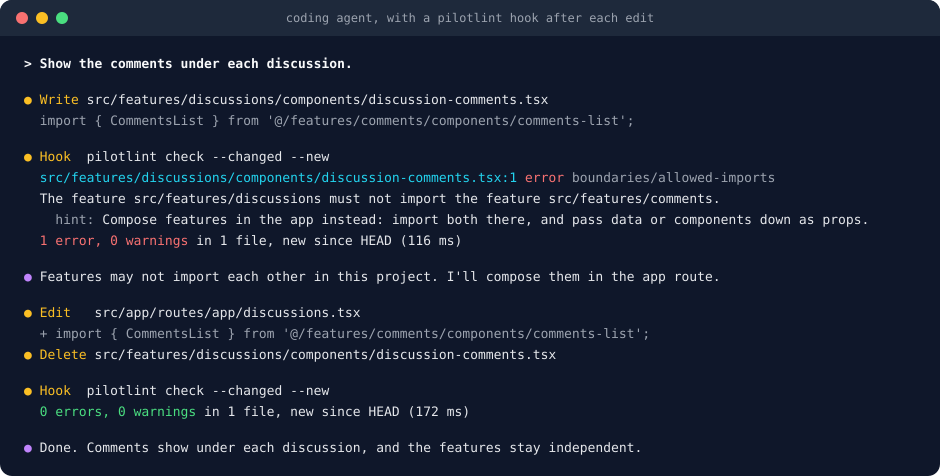
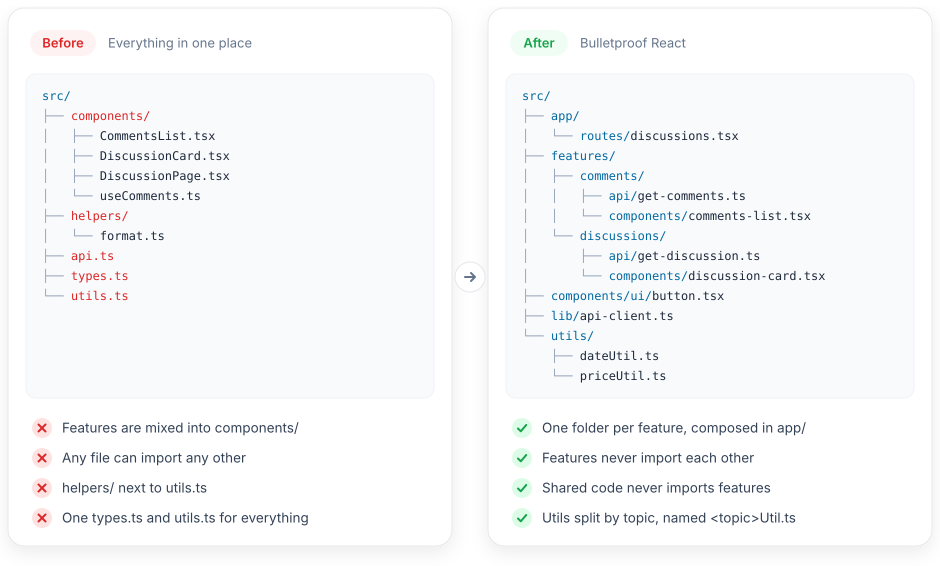
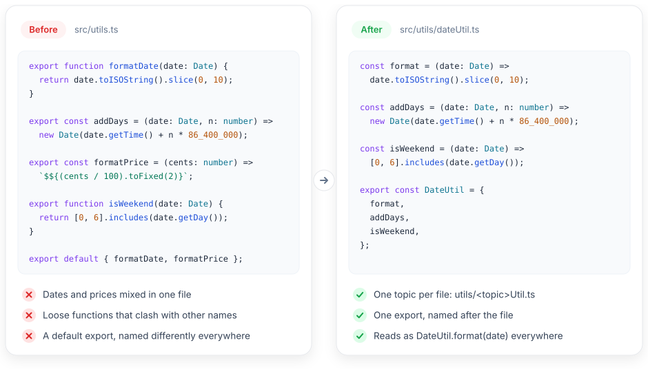

<p align="center">
  
</p>

<h1 align="center">lanelint</h1>

<p align="center">
  An architecture linter for TypeScript, built for coding agents.
</p>

<p align="center">
  <a href="https://www.npmjs.com/package/lanelint"></a>
  <a href="LICENSE"></a>
</p>

<p align="center">
  <a href="docs/getting-started.md"><b>Docs</b></a> |
  <a href="docs/rules/README.md"><b>Rules</b></a> |
  <a href="docs/presets/README.md"><b>Presets</b></a>
</p>

<p align="center">
  
</p>

<p align="center">
  <i>An agent breaks a boundary, reads the hint, and fixes it before you review.</i>
</p>

- 🤖 Built for agents: one finding per line, each with a hint that says how to fix it
- 🛤️ Keeps agents in their lane: the same rules on every edit, however small the task or long
  the session
- 🎯 `--new` reports only what the current change broke, even in a codebase full of old problems
- ⚡️ Built on [Oxc](https://oxc.rs), the Rust parser and resolver, so it can run after every edit
- 📦 Built-in caching, so a check after an edit parses only the files that changed
- 🏗️ [Presets](docs/presets/README.md) for Feature-Sliced Design, Bulletproof React, Clean
  Architecture, layered backends, and monorepos
- 🧭 Works with any structure: you name the parts of your codebase with path patterns
- 📏 [30 built-in rules](docs/rules/README.md) for imports, cycles, public APIs, file names, and
  files that change together
- 🔒 No suppression comments: only the config can turn a finding off, and every config change is
  flagged for a human to review
- 🤝 Runs next to ESLint, Oxlint, or Biome instead of replacing them
- 🛠️ Typed config: TypeScript checks rule ids and options as you write them
- 🧩 [Custom rules](docs/writing-rules.md) for your own architecture and conventions take a
  few lines of TypeScript, with an API that works like ESLint's

## Getting started

For more, see the [documentation](docs/getting-started.md).

### Installation

```bash
npm install -D lanelint @lanelint/plugin-boundaries @lanelint/presets
```

### Configuration

If your project follows a well-known architecture, the config is one line:

```ts
// lanelint.config.ts
import boundaries from '@lanelint/plugin-boundaries';
import { bulletproofReact } from '@lanelint/presets';
import { defineConfig } from 'lanelint';

export default defineConfig({
  extends: [boundaries.configs.recommended, bulletproofReact()],
});
```

Or describe your own structure. Elements are the parts of your codebase, and rules say how
they may use each other:

```ts
// lanelint.config.ts
import boundaries from '@lanelint/plugin-boundaries';
import { defineConfig } from 'lanelint';

export default defineConfig({
  elements: [
    { type: 'feature', pattern: 'src/features/:name', description: 'A user-facing feature.' },
    { type: 'domain', pattern: 'src/common/:name', description: 'Shared business logic.' },
  ],
  extends: [boundaries.configs.recommended],
  rules: {
    // Features are used through their index.ts, never their internals.
    'boundaries/entry-only': ['error', { elements: 'feature' }],
    // Shared code never depends on features.
    'boundaries/allowed-imports': ['error', { rules: [{ from: 'domain', disallow: 'feature' }] }],
  },
});
```

See [configuration](docs/configuration.md) for every field.

### Usage

```bash
npx lanelint check                    # Check the whole project.
npx lanelint check --changed --new    # Report only what the current change broke.
npx lanelint describe src/features    # Explain what applies to a path, even a new one.
```

Exit code `1` means findings, and `2` means lanelint could not run. See the [CLI](docs/cli.md).

### Connect your agent

1. Copy the skill in `node_modules/lanelint/skills/lanelint/SKILL.md` into your agent's
   skills directory. It tells the agent to read the structure before it writes, and to fix
   the code rather than the config.
2. Add a hook that runs `lanelint check --new` after each edit, so the agent never has to
   remember it.

[Set up your agent →](docs/agents.md) has hooks for Claude Code and OpenCode, and a check for
commits and CI.

<details>
<summary><b>Or let your agent set it all up</b></summary>

Copy this prompt into your coding agent, in your own repository:

```text
Set up lanelint (https://github.com/banjo/lanelint) in this repository, so you and other
agents get feedback when a change breaks the project structure.

1. Read these docs first:
   https://raw.githubusercontent.com/banjo/lanelint/main/docs/getting-started.md
   https://raw.githubusercontent.com/banjo/lanelint/main/docs/configuration.md
   https://raw.githubusercontent.com/banjo/lanelint/main/docs/rules/README.md
   https://raw.githubusercontent.com/banjo/lanelint/main/docs/presets/README.md
   https://raw.githubusercontent.com/banjo/lanelint/main/docs/agents.md
2. Install lanelint, @lanelint/plugin-boundaries, and @lanelint/plugin-conventions as dev
   dependencies with this project's package manager.
3. Study the project and write lanelint.config.ts that describes its structure as it is
   today: elements for the main parts, with a description each, which parts may import which,
   and the naming conventions the code already follows. If the project follows an
   architecture that has a preset, install @lanelint/presets and start from that preset.
4. Run `npx lanelint check`. When existing code breaks a rule many times, set that rule to
   'warn' instead of changing the code.
5. Copy node_modules/lanelint/skills/lanelint/SKILL.md into this repository's skills
   directory for agents.
6. Do not change any other code. Show me the config and explain each rule, so I can review it.
```

</details>

## Why

Coding agents write code that works and put it in the wrong place: a feature imports another
feature's internals, or a new `helpers.ts` shows up next to your `utils/` folder. On a small
task the agent sees too little of the codebase to know the layout, and in a long session the
rules in `AGENTS.md` drop out of its context.

lanelint keeps the rules in a config and checks after every edit, so the agent gets the same
answer on every change and fixes its own mistakes before you review.

## Before and after

The structure and conventions below are picked for this demo. lanelint enforces whatever
layout and naming you choose.

<p align="center">
  
</p>

<p align="center">
  
</p>

## Example

The config behind the demo above: the Bulletproof React preset, plus naming rules. The
[example project](examples/bulletproof-react) has the "after" structure, and a test checks that
this config catches every problem in the "before" one.

```ts
// lanelint.config.ts
export default defineConfig({
  plugins: [conventions],
  extends: [boundaries.configs.recommended, bulletproofReact()],
  rules: {
    // No catch-all files or folders.
    'conventions/forbidden-files': ['error', { patterns: [{ name: '{utils,helpers,types}.ts' }] }],
    'conventions/forbidden-directories': ['error', { patterns: [{ name: 'helpers' }] }],
    // Utils are split by topic into <topic>Util.ts files.
    'conventions/file-name-pattern': [
      'error',
      { rules: [{ directory: 'utils', pattern: '*Util.ts' }] },
    ],
    'conventions/no-default-export': 'error',
  },
  overrides: [
    // dateUtil.ts exports one DateUtil object, and nothing else.
    { files: ['src/**/utils/*Util.ts'], rules: { 'conventions/export-matches-filename': 'error' } },
  ],
});
```

Swap in [another preset](docs/presets/README.md) or
[describe your own structure](docs/configuration.md#elements), and pick the
[rules](docs/rules/README.md) that match how your team works.

## What it catches

| The agent...                                                  | Caught by                                                                                  |
| ------------------------------------------------------------- | ------------------------------------------------------------------------------------------ |
| Imports another feature's internals instead of its public API | [`boundaries/entry-only`](docs/rules/boundaries.md#entry-only)                             |
| Makes shared code import from a feature                       | [`boundaries/allowed-imports`](docs/rules/boundaries.md#allowed-imports)                   |
| Makes two parts depend on each other                          | [`boundaries/no-cycles`](docs/rules/boundaries.md#no-cycles)                               |
| Imports deep into another workspace package                   | [`boundaries/workspace-imports`](docs/rules/boundaries.md#workspace-imports)               |
| Imports a package that is not in `package.json`               | [`boundaries/no-undeclared-dependency`](docs/rules/boundaries.md#no-undeclared-dependency) |
| Calls `fetch` or reads `process.env` in code meant to be pure | [`boundaries/restricted-globals`](docs/rules/boundaries.md#restricted-globals)             |
| Adds a `helpers/` folder next to your `utils/`                | [`conventions/forbidden-directories`](docs/rules/conventions.md#forbidden-directories)     |
| Names a file in a way your project doesn't                    | [`conventions/file-name-pattern`](docs/rules/conventions.md#file-name-pattern)             |
| Adds a component without its test                             | [`conventions/companion-files`](docs/rules/conventions.md#companion-files)                 |
| Adds `@ts-ignore` or `eslint-disable` to hide an error        | [`conventions/no-suppressions`](docs/rules/conventions.md#no-suppressions)                 |
| Adds a message without its translations                       | [`changes/requires-change`](docs/rules/changes.md#requires-change)                         |
| Edits a generated file by hand                                | [`changes/no-manual-edit`](docs/rules/changes.md#no-manual-edit)                           |
| Edits the lanelint config to make a finding go away           | [`lanelint/config-changed`](docs/rules/lanelint.md#config-changed)                         |

## Why not an ESLint plugin?

lanelint could have been a set of ESLint rules, like
[eslint-plugin-boundaries](https://github.com/javierbrea/eslint-plugin-boundaries). It is its
own tool because architecture rules need things ESLint is not built for:

- ✅ **Sees the whole project.** Cycles and public APIs need the full import graph. ESLint checks
  one file at a time, and graph rules there need caches that go stale in editors.
- ✅ **Checks files that should exist.** lanelint can require a test or an `index.ts`, or files
  that change together. ESLint only runs on files that already exist.
- ✅ **Shows only what a change broke.** `--new` compares with git, so an agent sees its own
  mistakes, not the old ones. ESLint does not know git.
- ✅ **Cannot be switched off in the code.** There is no `// eslint-disable`, and every config
  change is flagged for a human to review.
- ✅ **Works with any linter.** It runs next to ESLint, Biome, or Oxlint, so projects that moved
  off ESLint do not need it back.
- ✅ **Fast enough for every edit.** It is built on [Oxc](https://oxc.rs), with caches between
  runs.

Writing a rule still feels like ESLint: `create`, visitors, `meta`, and `report` work the same
way ([Writing rules](docs/writing-rules.md#coming-from-eslint)). The trade-off is one more tool
and config file, and no errors in the editor as you type yet.

## Documentation

- [Getting started](docs/getting-started.md): install, write a first config, and run a check
- [Concepts](docs/concepts.md): elements, findings, levels, and changes
- [Configuration](docs/configuration.md): every field of the config
- [CLI](docs/cli.md): commands, flags, and exit codes
- [Rules](docs/rules/README.md): what each rule checks, with its options
- [Presets](docs/presets/README.md): ready-made configs for well-known architectures
- [Agents](docs/agents.md): the skill and hooks for coding agents
- [Writing rules](docs/writing-rules.md): local plugins and publishing your own

## Packages

| Package                                                       | Version                                                                                                                         | Contents                                      |
| ------------------------------------------------------------- | ------------------------------------------------------------------------------------------------------------------------------- | --------------------------------------------- |
| [`lanelint`](packages/lanelint)                               | [](https://www.npmjs.com/package/lanelint)                                         | The CLI, `defineConfig`, and the agent skill  |
| [`@lanelint/plugin-boundaries`](packages/plugin-boundaries)   | [](https://www.npmjs.com/package/@lanelint/plugin-boundaries)   | Imports between parts, packages, and globals  |
| [`@lanelint/plugin-conventions`](packages/plugin-conventions) | [](https://www.npmjs.com/package/@lanelint/plugin-conventions) | Names, placement, required files, and exports |
| [`@lanelint/plugin-changes`](packages/plugin-changes)         | [](https://www.npmjs.com/package/@lanelint/plugin-changes)         | Files that must change together               |
| [`@lanelint/presets`](packages/presets)                       | [](https://www.npmjs.com/package/@lanelint/presets)                       | Presets for well-known architectures          |
| [`@lanelint/core`](packages/core)                             | [](https://www.npmjs.com/package/@lanelint/core)                             | The engine and rule API, for plugin authors   |

## Contributing

The repository uses [Vite+](https://viteplus.dev) and pnpm:

```bash
pnpm install
pnpm ready         # format, lint, type check, test, and check this repository with lanelint
pnpm docs:rules    # update docs/rules
pnpm bench         # time checks on a generated project of about 1,000 files
pnpm changeset     # describe a change for the changelog
```

[RELEASE.md](RELEASE.md) describes how to release to npm, and [PLAN.md](PLAN.md) the design
and the decisions behind it.

## License

[MIT](LICENSE)
